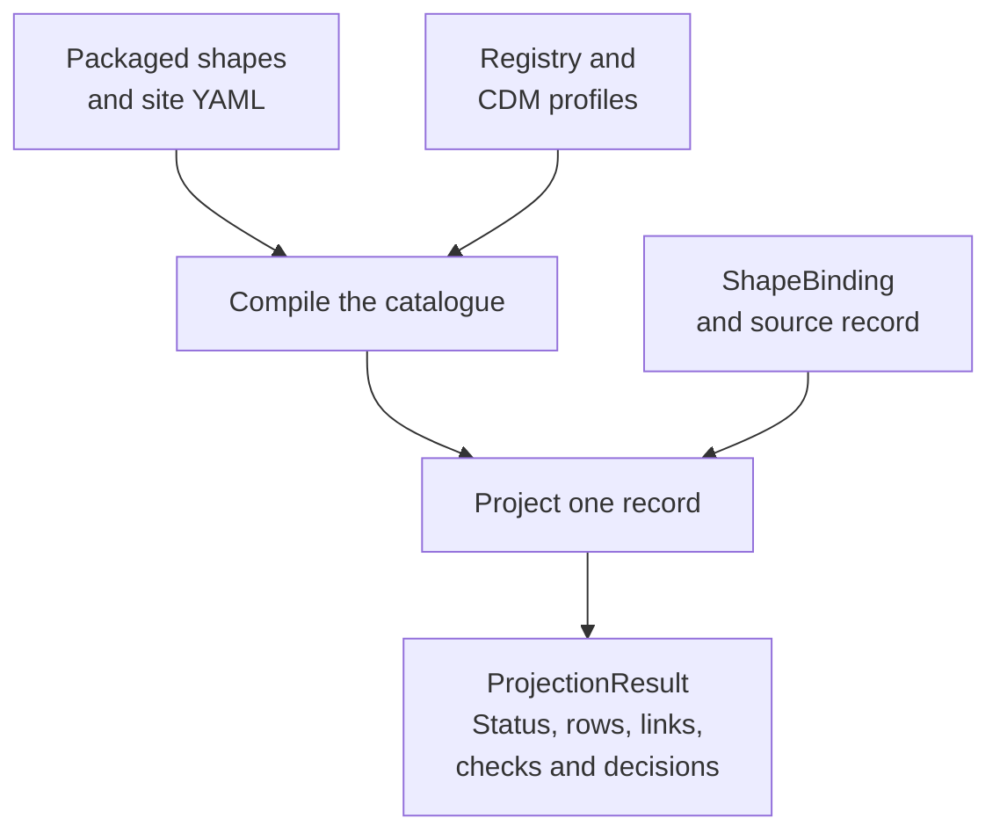
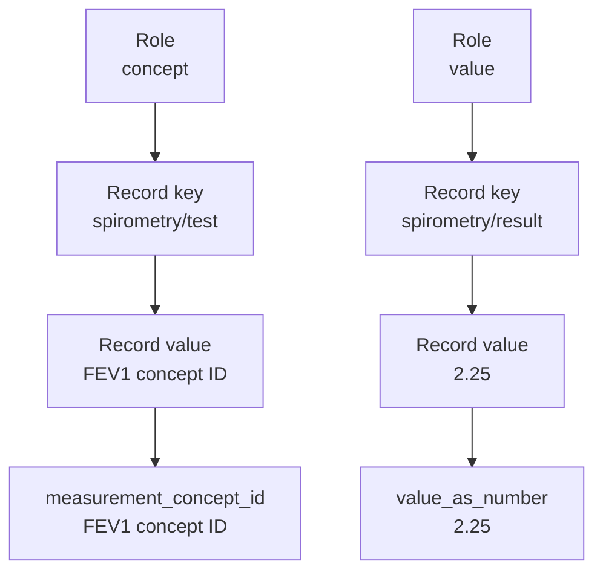
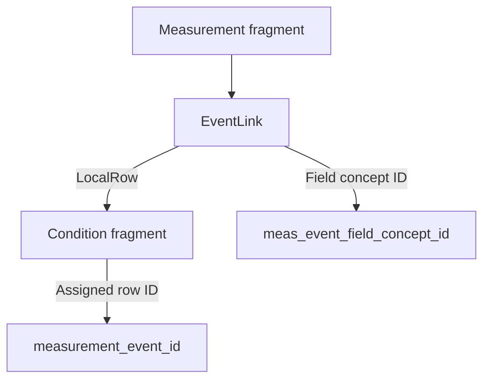

# Semantic projection

`omop_semantics.projection.ShapeRuntime` compiles YAML shapes and projects a record into OMOP row fragments. The caller supplies grounded concept IDs, source fields and, optionally, a vocabulary oracle. The caller writes the rows.



Load the catalogue once and reuse the runtime across records. The binding chooses a shape and identifies the source keys it reads.

```python
from omop_semantics.projection import ShapeBinding, ShapeRuntime
from omop_semantics.runtime.default_valuesets import runtime as registry

runtime = ShapeRuntime.from_yaml_paths()
binding = ShapeBinding(
    shape="numeric_measurement",
    roles={"concept": "spirometry/test", "value": "spirometry/result"},
)
result = runtime.project(
    binding,
    {
        "spirometry/test": registry.measurements_numeric.lab_measurements.fev1,
        "spirometry/result": 2.25,
    },
)
bundle = result.to_dict()
```

## How a binding supplies values

In the spirometry example, each role names an input the shape needs. The binding identifies the record key for that input, and the shape's CDM profile determines the destination column.



Persist a binding with `binding.model_dump_json()` and restore it with `ShapeBinding.model_validate_json(...)`. The keys in `roles` and `context` are declared by the shape. Their values are opaque keys in the supplied record. A shape can mark inputs as `optional_roles` or `optional_context`. Use `runtime.check_binding(binding)` to review the wiring before projecting. `project()` raises `BindingError` with those same issues if the binding is invalid. A record can still be missing a value for a correctly bound input.

For `criteria_gate_condition` and `yes_no_observation`, bind source conventions through `codes={"yes": ("Y",), "no": ("N",)}`. A membership predicate can reference one or more groups through `codes_from`. A `binding_codes` map associates each group with a concept. Codes within that map must resolve to a single group. The default gate suppresses a negative or unanswered record. A site can replace the shape to require an answer.

## Record values

| Input | Accepted representation |
| --- | --- |
| Absent | `None`, blank text, floating NaN, pandas `NA` and `NaT`, NumPy datetime `NaT` |
| Concept IDs and other integers | Integers, integral finite real values, or ASCII decimal strings. Booleans are invalid IDs. |
| Numeric values | Finite real numbers or strings that parse to a finite number |
| Source codes | Nonblank strings as supplied, integers and integral reals as decimal text, booleans as `"true"` or `"false"` |
| Event dates | Python dates, datetimes, or ISO `YYYY-MM-DD` strings |

## Site catalogues

Pass site paths to `ShapeRuntime.from_yaml_paths([path1, path2])`. Each file contains a `shapes` list. A later layer replaces a whole shape with the same name. `ShapeLoadError.errors` lists failures across shapes and layers with file and key. `runtime.names()` lists the effective catalogue. `runtime.get(name)` returns a shape definition. The [authoring schema](schemas/omop_shape.schema.json) is generated from `OmopShape.model_json_schema()`. Use `ShapeBinding.model_json_schema()` for the binding schema.

```yaml
shapes:
  - name: local_condition_with_status
    version: "1"
    roles: [diagnosis, status]
    optional_roles: [status]
    context: [form_date, visit_date, use_form_date]
    optional_context: [form_date, use_form_date]
    rows:
      - id: condition
        profile: condition_with_status
        concept: {role: diagnosis}
        constraints:
          - {kind: domain, reference: Condition}
          - {kind: standard_only}
        value: {kind: presence}
        context:
          event_date:
            - source: {context: form_date}
              when: {source: {context: use_form_date}, test: in, codes: ["yes"]}
            - source: {context: visit_date}
        derivations:
          - target_slot: condition_status_concept_id
            source: {role: status}
            when: {source: {role: status}, test: answered}
            mapping: {external_map: local-condition-status}
```

- A shape fixes a concept by registry reference `value_set.unit.label` or reads a grounded ID. A `registry_labels` map expects exact registry member labels  from the named `value_set.unit`. Those labels are a versioned source contract. Use `code_map` for inline source codes and `external_map` for a caller-supplied map. Pass a loaded STCM as `external_maps={"local-condition-status": {"source-code": concept_id}}`.
- `exact` checks a single concept and `members` checks the exact members of a semantic unit. `descendants` checks the parent anchors and exclusions within each group. `composite` also admits exact members. Domain constraints use the clinical event domains from the [OMOP CDM 5.4 specification](https://ohdsi.github.io/CommonDataModel/cdm54.html). Hierarchy, domain and standard checks use a `VocabularyOracle` when their answer depends on the vocabulary. Those checks report `deferred` when it is unavailable.
- Value kinds are `presence`, `coded`, `ordinal`, `numeric`, `numeric_from_code`, `numeric_with_unit`, and `partial_date`. An ordinal declares named concepts in order and reports its one-based `value_rank` on the row alongside `fields`. Operator inputs work for numeric profiles that expose an operator slot. A unit policy can constrain and convert units. Reference ranges use the same conversion. Partial dates retain their precision.
- Event-date sources are tried in order, skipping absent values or false predicates. A malformed supplied date is invalid. Visit and care-site IDs bind to profiles that have the corresponding CDM column.
- `suppress_when`, special values, derivations and links share predicates. `keep_as_value` writes a named fallback from the unknown catalogue and reports its reason in `value_decisions`. The `asked_declined` reason corresponds to [FHIR DataAbsentReason](https://hl7.org/fhir/valueset-data-absent-reason.html). A derivation that fails leaves its slot unset and records an issue. Set `required: true` if that issue should make the result partial.

## Event links

A measurement fragment can link to a condition fragment produced from the same record. The link identifies the condition by its row name until the caller assigns its physical CDM ID.



An event link uses a registered `mechanism`, a `source_row`, and either a `target_row` in the same shape or `target_item` plus `target_table` for an external row. Supply an external target as `BoundRow(table, id)` or a mapping with those fields. Assign an internal target's physical key before writing the event ID to the CDM. A suppressed local target skips the link and records a `link_decision`. It also suppresses the source row when `required_target` is true, the default.

## Result states

| State | Meaning |
| --- | --- |
| `ok` | Required projections resolved. Optional slot issues and deferred checks may be present. |
| `partial` | A required row, derivation or link could not be resolved. |
| `suppressed` | All rows were intentionally omitted by policy. |
| `invalid` | A supplied value, special-value policy or constraint failed. Inspect issues and checks for the cause. |

Results include the shape version and layer source, registry version, rows, links, checks, issues and decisions. `maps` contains the name and SHA-256 digest of each external map consulted, calculated from its JSON payload with sorted keys. For injected registries, pass `registry_version` with the loaded version.
